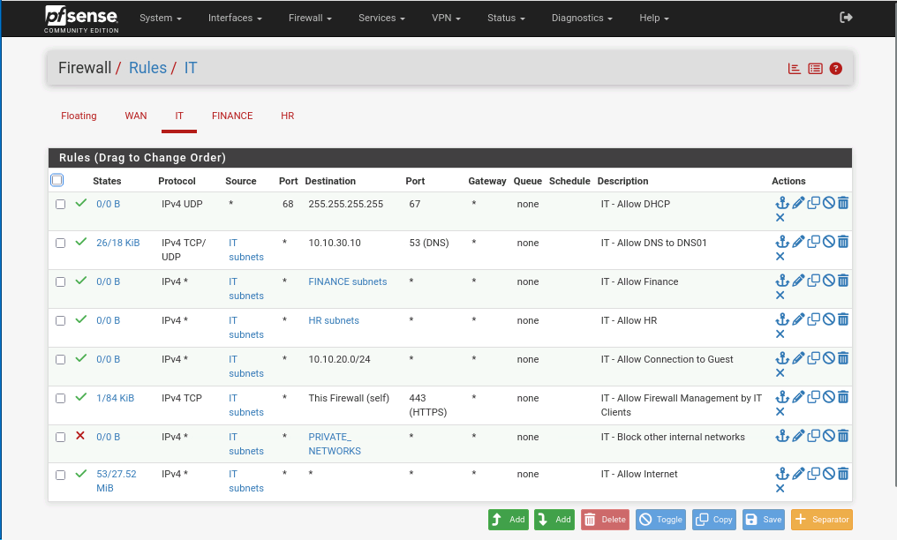
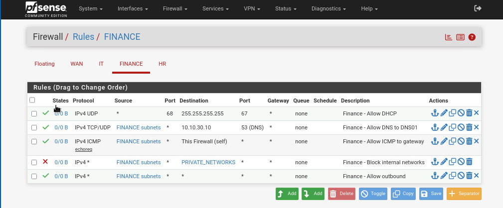
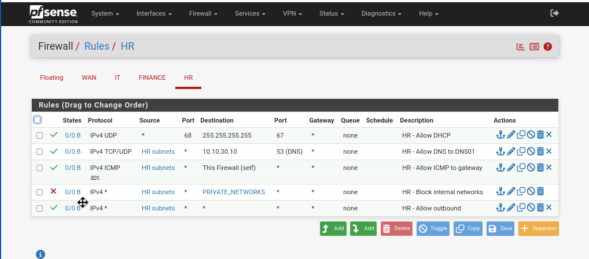
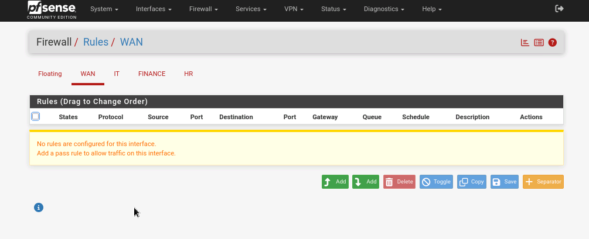

# Firewall Policy

**Updated:** 2026-11-21

This document records the active firewall policy for the current GNS3 Network Security Homelab.

The lab uses three firewall roles:

- **FortiGate** — perimeter firewall between the routed core and the GNS3 NAT/Internet.
- **pfSense-Internal** — segmentation firewall and default gateway for IT, Finance, and HR.
- **pfSense-Guest** — segmentation firewall and default gateway for the Guest network.

The policy follows a **default-deny** approach: traffic is permitted only when an explicit rule allows it, with broader allow rules placed below more specific exceptions and private-network blocks.

---

## 1. pfSense-Internal

### Interfaces

| Interface | Address | Role |
|---|---|---|
| WAN | `10.10.252.2/30` | Transit toward R1 |
| IT | `10.10.10.1/24` | IT gateway / VLAN 10 |
| FINANCE | `10.10.40.1/24` | Finance gateway / VLAN 40 |
| HR | `10.10.50.1/24` | HR gateway / VLAN 50 |

The former LAN interface `192.168.1.1/24` has been removed.

### IT Interface Policy

Rules are evaluated top-down.



| Order | Action | Protocol | Source | Destination | Port | Purpose |
|---:|---|---|---|---|---|---|
| 1 | Allow | UDP | Any, source port 68 | `255.255.255.255` | 67 | Allow DHCP client broadcasts |
| 2 | Allow | TCP/UDP | IT subnets | `10.10.30.10` | 53 | Allow DNS to DNS01 |
| 3 | Allow | IPv4 any | IT subnets | Finance subnets | Any | Allow IT to manage/reach Finance |
| 4 | Allow | IPv4 any | IT subnets | HR subnets | Any | Allow IT to manage/reach HR |
| 5 | Allow | IPv4 any | IT subnets | `10.10.20.0/24` | Any | Allow IT to reach Guest for support |
| 6 | Allow | TCP | IT subnets | This Firewall (self) | 443 | Allow IT clients to manage pfSense-Internal over HTTPS |
| 7 | Allow | TCP | IT subnets | `10.10.253.2` | 443 | Allow IT to reach the pfSense-Guest management interface |
| 8 | Block | IPv4 any | IT subnets | `PRIVATE_NETWORKS` | Any | Block other private/internal networks not explicitly allowed above |
| 9 | Allow | IPv4 any | IT subnets | Any | Any | Allow Internet/non-private destinations |

### Finance Interface Policy



| Order | Action | Protocol | Source | Destination | Port | Purpose |
|---:|---|---|---|---|---|---|
| 1 | Allow | UDP | Any, source port 68 | `255.255.255.255` | 67 | Allow DHCP client broadcasts |
| 2 | Allow | TCP/UDP | Finance subnets | `10.10.30.10` | 53 | Allow DNS to DNS01 |
| 3 | Allow | ICMP echo request | Finance subnets | This Firewall (self) | Any | Allow gateway reachability testing |
| 4 | Block | IPv4 any | Finance subnets | `PRIVATE_NETWORKS` | Any | Block access to private/internal networks |
| 5 | Allow | IPv4 any | Finance subnets | Any | Any | Allow Internet/non-private destinations |

Because the private-network block occurs before the final outbound allow, Finance cannot initiate connections to IT, HR, Guest, or other RFC1918 internal networks.


### HR Interface Policy



| Order | Action | Protocol | Source | Destination | Port | Purpose |
|---:|---|---|---|---|---|---|
| 1 | Allow | UDP | Any, source port 68 | `255.255.255.255` | 67 | Allow DHCP client broadcasts |
| 2 | Allow | TCP/UDP | HR subnets | `10.10.30.10` | 53 | Allow DNS to DNS01 |
| 3 | Allow | ICMP echo request | HR subnets | This Firewall (self) | Any | Allow gateway reachability testing |
| 4 | Block | IPv4 any | HR subnets | `PRIVATE_NETWORKS` | Any | Block access to private/internal networks |
| 5 | Allow | IPv4 any | HR subnets | Any | Any | Allow Internet/non-private destinations |

Because the private-network block occurs before the final outbound allow, HR cannot initiate connections to IT, Finance, Guest, or other RFC1918 internal networks.

### WAN Interface Policy




I intentionally did not configure explicit pass rules on the pfSense-Internal WAN interface.

The WAN interface is the transit link toward R1, not the public Internet. Traffic initiated from IT, Finance, or HR is evaluated when it enters pfSense on the corresponding internal interface. When an allow rule creates a firewall state, related return traffic arriving through WAN is automatically permitted.

Unsolicited traffic arriving from R1/core networks does not match an allow rule and is denied by pfSense's default-deny behavior.

This provides a useful security boundary:

```text
IT / Finance / HR initiated traffic
        -> evaluated on internal interface
        -> allowed if policy permits
        -> state created
        -> reply traffic allowed automatically

Core / remote network initiated traffic
        -> enters pfSense-Internal on WAN
        -> no WAN pass rule
        -> denied by default
```
---

## 2. pfSense-Guest

### Interfaces

| Interface | Address | Role |
|---|---|---|
| WAN | `10.10.253.2/30` | Transit toward R3 |
| LAN | `10.10.20.1/24` | Guest default gateway |

### Guest WAN Policy

| Order | Action | Protocol | Source | Destination | Purpose |
|---:|---|---|---|---|---|
| 1 | Block | Any | Reserved/bogon sources | Any | Block invalid/unallocated source networks |
| 2 | Allow | TCP | `10.10.10.0/24` | WAN address (`10.10.253.2`) | 443 | Allow HQ IT to manage pfSense-Guest over HTTPS |
| 3 | Allow | IPv4 any | `10.10.10.0/24` | LAN subnets | Any | Allow HQ/IT access to Guest hosts for support |
| 4 | Allow | ICMP echo request | `10.10.253.1` | `10.10.253.2` | Any | Allow R3 to ping the pfSense-Guest WAN interface |

The complete HQ IT management path requires matching permission on both firewalls:

- **pfSense-Internal IT interface:** allow `10.10.10.0/24` to `10.10.253.2` on TCP/443.
- **pfSense-Guest WAN interface:** allow `10.10.10.0/24` to the WAN address `10.10.253.2` on TCP/443.

This path has been tested successfully from the IT network using `https://10.10.253.2`.

The following rule separately permits IT clients from `10.10.10.0/24` to initiate connections toward Guest hosts for support and troubleshooting.

### Guest LAN Policy

| Order | Action | Protocol | Source | Destination | Port | Purpose |
|---:|---|---|---|---|---|---|
| 1 | Allow | TCP/UDP | LAN subnets | `10.10.30.10` | 53 | Allow DNS to DNS01 |
| 2 | Allow | ICMP echo request | LAN subnets | This Firewall (self) | Any | Allow gateway reachability testing |
| 3 | Block | IPv4 any | LAN subnets | `PRIVATE_NETWORKS` | Any | Block Guest access to internal/private networks |
| 4 | Allow | IPv4 any | LAN subnets | Any | Any | Allow Internet/non-private destinations |

The DNS exception must be above the private-network block because DNS01 (`10.10.30.10`) is itself inside private RFC1918 address space.

### Guest Management Hardening

Trusted remote management from the HQ IT network is explicitly configured on the pfSense-Guest WAN interface:

```text
Source:      10.10.10.0/24
Destination: WAN address (10.10.253.2)
Protocol:    TCP
Port:        443
Action:      Allow
```

The matching pfSense-Internal IT-interface rule permits `10.10.10.0/24` to reach `10.10.253.2` on TCP/443.

This path has been tested successfully from the HQ IT network.

The default webConfigurator anti-lockout rule on pfSense-Guest has now been disabled. Guest-LAN clients therefore no longer receive automatic GUI access on ports 80/443; management access is controlled by explicit firewall rules instead.

The intended management model is now:

```text
HQ IT -> pfSense-Guest HTTPS/443 -> Allow
Guest clients -> pfSense-Guest GUI -> Deny
```

---

## 3. Effective Segmentation Matrix

| Source | IT | Finance | HR | Guest | DNS01 | Internet | pfSense-Internal GUI | pfSense-Guest GUI |
|---|---:|---:|---:|---:|---:|---:|---:|---:|
| IT | Local | Allow | Allow | Allow | DNS allowed | Allow | HTTPS allowed | HTTPS allowed |
| Finance | Block | Local | Block | Block | DNS allowed | Allow | Block | Block |
| HR | Block | Block | Local | Block | DNS allowed | Allow | Block | Block |
| Guest | Block | Block | Block | Local | DNS allowed | Allow | Not intended | Blocked |
| Core/other networks | Default deny at pfSense-Internal WAN | Default deny | Default deny | Depends on Guest WAN rules | N/A | N/A | Default deny | Default deny except explicit WAN rules |

---

## 4. Stateful Firewall Behavior

pfSense is stateful.

When a permitted connection is initiated, pfSense creates a state entry containing information such as source, destination, protocol, and ports.

This means a reverse-direction rule is not required merely for reply traffic.

Example:

```text
IT client -> Finance host
        allowed by IT interface rule
        state created

Finance host -> reply to same IT session
        allowed by existing state
```

This does **not** mean Finance is allowed to initiate a new connection toward IT. A new Finance-initiated session is evaluated against the Finance interface rules and is blocked by the `PRIVATE_NETWORKS` rule.

---

## 5. Policy Design Principles

The current ruleset follows these principles:

1. **Default deny** — traffic is denied unless explicitly permitted.
2. **Least privilege** — exceptions are added only for required services or administrative access.
3. **Rule ordering matters** — specific exceptions appear above broad private-network blocks.
4. **Centralized infrastructure access** — DHCP and DNS are explicitly allowed before segmentation blocks.
5. **Administrative separation** — IT receives broader access than Finance, HR, and Guest.
6. **Stateful return traffic** — return packets for permitted sessions do not require duplicate reverse rules.
7. **Layered security** — FortiGate provides perimeter protection while pfSense performs internal segmentation.

---

## 6. Current Verified Behavior

The current firewall configuration has been tested successfully for:

- IT Internet access.
- Finance Internet access.
- HR Internet access.
- Guest Internet access.
- IT access to Finance.
- IT access to HR.
- IT access to Guest.
- Finance-to-IT blocking.
- Finance-to-HR blocking.
- HR-to-IT blocking.
- HR-to-Finance blocking.
- Guest-to-private-network blocking.
- DNS access from all client networks to `10.10.30.10`.
- DHCP operation through pfSense relay.
- IT HTTPS management of pfSense-Internal at `10.10.10.1`.
- HQ IT HTTPS management of pfSense-Guest at `10.10.253.2`, through explicit TCP/443 rules on both pfSense-Internal and pfSense-Guest.
- Guest-LAN automatic webConfigurator access removed by disabling the pfSense anti-lockout rule.

