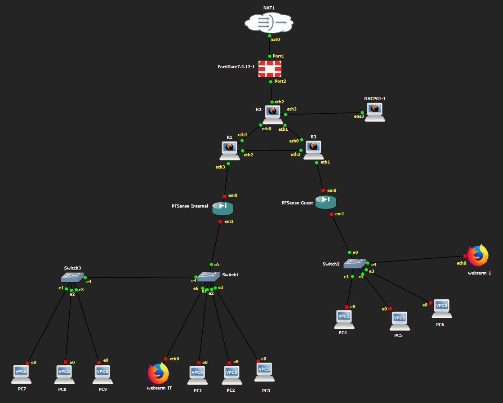
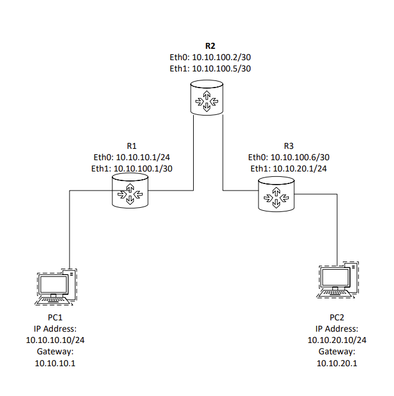
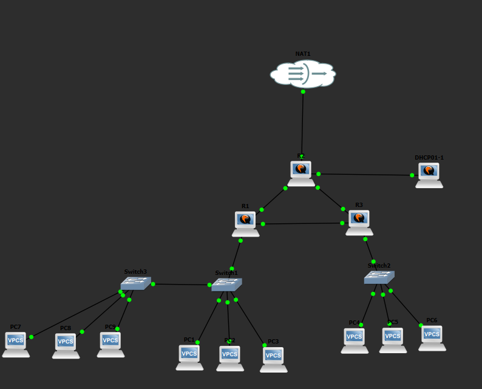

# Network Topology

This directory documents the evolution of the GNS3 network-security homelab. The lab began as a small routed network, then added OSPF redundancy, centralized DHCP/DNS, VLAN segmentation, Internet connectivity, and finally dedicated firewall layers using FortiGate and pfSense.

---

## Current Topology

The current design separates the network into three major layers:

1. **Perimeter security** — FortiGate between the routed core and the GNS3 NAT/Internet.
2. **Routed core** — VyOS routers R1, R2, and R3 running OSPF Area 0.
3. **Internal segmentation** — pfSense-Internal protects IT, Finance, and HR; pfSense-Guest protects the Guest network.

### Current GNS3 Topology



### Logical Overview

```text
                           Internet
                              |
                          GNS3 NAT
                              |
                          FortiGate
                              |
                        10.10.254.0/30
                              |
                              R2
                            /    \
                           /      \
                         R1--------R3
                          |        |
                10.10.252.0/30   10.10.253.0/30
                          |        |
                pfSense-Internal  pfSense-Guest
                          |        |
                        Switch1   Switch2
                          |
                       Switch3
```

DHCP01/DNS01 is connected directly to R2 on the `10.10.30.0/24` server network.

---

## Network Roles

| Device | Role |
|---|---|
| FortiGate | Perimeter firewall between the routed core and GNS3 NAT/Internet |
| R1 | Core router for the internal-firewall side; OSPF participant |
| R2 | Core/server router and upstream router toward FortiGate; OSPF participant |
| R3 | Core router for the Guest-firewall side; OSPF participant |
| pfSense-Internal | Default gateway, DHCP relay, and security-policy enforcement for IT, Finance, and HR |
| pfSense-Guest | Default gateway, DHCP relay, and security-policy enforcement for Guest |
| DHCP01 | Centralized Kea DHCPv4 and BIND9 DNS server |
| Switch1 | Primary internal access switch and trunk toward pfSense-Internal |
| Switch3 | Secondary internal access switch connected to Switch1 by 802.1Q trunk |
| Switch2 | Guest access switch |
| webterm-IT | DHCP-based IT workstation with HTTPS management access to pfSense-Internal |
| webterm-1 | Guest-side Webterm used for Guest testing and pfSense-Guest access |

---

## Addressing Summary

| Network | Purpose |
|---|---|
| `10.10.10.0/24` | IT VLAN 10 |
| `10.10.20.0/24` | Guest network |
| `10.10.30.0/24` | Server network / DHCP01 / DNS01 |
| `10.10.40.0/24` | Finance VLAN 40 |
| `10.10.50.0/24` | HR VLAN 50 |
| `10.10.100.0/30` | R1-R2 transit |
| `10.10.100.4/30` | R2-R3 transit |
| `10.10.100.8/30` | Direct R1-R3 transit |
| `10.10.252.0/30` | R1-pfSense-Internal transit |
| `10.10.253.0/30` | R3-pfSense-Guest transit |
| `10.10.254.0/30` | R2-FortiGate transit |

The primary internal address space remains `10.10.0.0/16`.

For detailed interface-by-interface addressing, see [../docs/addressing-plan.md](../docs/addressing-plan.md).

---

## OSPF Core

R1, R2, and R3 form an OSPF Area 0 triangle.

```text
                         R2
                       /    \
                      /      \
                    R1--------R3
```

### Core Transit Networks

- R1-R2: `10.10.100.0/30`
- R2-R3: `10.10.100.4/30`
- R1-R3: `10.10.100.8/30`

The direct R1-R3 link provides an alternate path around R2 for internal routed traffic and allows OSPF to reconverge if one core link fails.

R2 also advertises the `10.10.30.0/24` server network into OSPF using its server-facing interface as a passive interface.

### Protected Networks and OSPF Redistribution


| Network | Role | Default Gateway |
|---|---|---|
| `10.10.10.0/24` | IT / VLAN 10 | `10.10.10.1` on pfSense-Internal |
| `10.10.20.0/24` | Guest | `10.10.20.1` on pfSense-Guest |
| `10.10.30.0/24` | Server network | `10.10.30.1` on R2 |
| `10.10.40.0/24` | Finance / VLAN 40 | `10.10.40.1` on pfSense-Internal |
| `10.10.50.0/24` | HR / VLAN 50 | `10.10.50.1` on pfSense-Internal |

### Core / Firewall Transit Networks

| Network | Purpose |
|---|---|
| `10.10.100.0/30` | R1-R2 |
| `10.10.100.4/30` | R2-R3 |
| `10.10.100.8/30` | R1-R3 |
| `10.10.252.0/30` | R1-pfSense-Internal |
| `10.10.253.0/30` | R3-pfSense-Guest |
| `10.10.254.0/30` | R2-FortiGate |

The full interface addressing plan is documented in [`docs/addressing-plan.md`](docs/addressing-plan.md).

---

## Routing Design

R1, R2, and R3 form a redundant OSPF Area 0 triangle.

```text
                         R2
                       /    \
                      /      \
                    R1--------R3
```

**R1 to Internal Networks**

The protected client networks are no longer directly connected to R1 or R3.

R1 reaches the IT, Finance, and HR networks behind pfSense-Internal using static routes:

|Destination network|  Next hop|
|---|---|
|`10.10.10.0/24` (IT) |         via `10.10.252.2`|
|`10.10.40.0/24` (Finance)|         via `10.10.252.2`|
|`10.10.50.0/24` (HR) |        via `10.10.252.2`|

`10.10.252.2` is the transit/WAN address of pfSense-Internal.

These static routes are selectively redistributed into OSPF so R2 and R3 can also learn how to reach the IT, Finance, and HR networks.

**R3 to Guest Network**

R3 reaches the Guest network using a static route as well:

|Destination network|  Next hop|
|---|---|
|`10.10.20.0/24` | via `10.10.253.2` | 

`10.10.253.2` is the transit/WAN address of pfSense-Guest.

The Guest route is also selectively redistributed into OSPF so R1 and R2 can learn how to reach the Guest network.

**R2 to FortiGate**

R2 uses FortiGate as its upstream gateway for Internet/North-bound traffic:

Destination network|  Next hop|
|---|---|
|`0.0.0.0/0` | via `10.10.254.1` | 

`10.10.254.1` is FortiGate's internal-facing interface connected to R2.

R2 originates this default route into OSPF so R1 and R3 dynamically learn that Internet-bound traffic should be forwarded toward R2.


---

## Internal VLAN and Switching Design

pfSense-Internal now owns the Layer 3 gateway addresses for IT, Finance, and HR.

| VLAN | Network | Gateway | Clients |
|---|---|---|---|
| 10 | `10.10.10.0/24` | `10.10.10.1` | PC1, PC7, webterm-IT |
| 40 | `10.10.40.0/24` | `10.10.40.1` | PC2, PC8 |
| 50 | `10.10.50.0/24` | `10.10.50.1` | PC3, PC9 |

Switch1 connects to pfSense-Internal using an 802.1Q trunk carrying VLANs 10, 40, and 50.

Switch1 and Switch3 are also connected by an 802.1Q trunk carrying those same VLANs.

The old R1 router-on-a-stick subinterfaces `eth0.10`, `eth0.40`, and `eth0.50` were removed after pfSense-Internal took over gateway ownership.

---

## Guest Design

The Guest network is now a single protected subnet behind pfSense-Guest:

```text
10.10.20.0/24
Gateway: 10.10.20.1
```

PC4, PC5, PC6, and webterm-1 connect through Switch2.

The earlier VLAN 60 and VLAN 70 design is no longer part of the current topology.

Guest traffic reaches the routed core through:

```text
Guest clients
    |
Switch2
    |
pfSense-Guest
    |
10.10.253.0/30
    |
R3
```

---

## Centralized DHCP and DNS

DHCP01 provides both Kea DHCPv4 and BIND9 DNS:

```text
DHCP01: 10.10.30.10/24
Gateway: 10.10.30.1
DNS server distributed to clients: 10.10.30.10
```

### DHCP Relay

DHCP relay now runs on the pfSense firewalls instead of R1/R3.

pfSense-Internal relays requests from:

- IT
- Finance
- HR

pfSense-Guest relays requests from:

- Guest

All requests are forwarded to:

```text
10.10.30.10
```

This keeps DHCP centralized while allowing the firewalls to remain the default gateways for the protected networks.

---

## Internet Path

The current Internet path is:

```text
Client
  |
pfSense
  |
R1 or R3
  |
R2
  |
FortiGate
  |
GNS3 NAT
  |
Internet
```

R2 uses a static default route toward FortiGate:

```text
0.0.0.0/0 -> 10.10.254.1
```

R2 originates the default route into OSPF so R1 and R3 learn Internet reachability dynamically.

FortiGate provides the perimeter firewall path to the GNS3 NAT node. Its WAN-facing address is obtained dynamically from the NAT node.

---

## Firewall Segmentation

pfSense-Internal enforces policy between IT, Finance, and HR.

Current behavior includes:

- IT can reach Finance.
- IT can reach HR.
- IT can reach the Guest network for support/troubleshooting.
- Finance cannot initiate traffic to IT or HR.
- HR cannot initiate traffic to IT or Finance.
- Finance and HR can reach DNS01 and the Internet.
- IT clients can manage pfSense-Internal over HTTPS at `10.10.10.1:443`.

pfSense-Guest blocks Guest-initiated access to internal private networks while still allowing Guest Internet access.

FortiGate provides the outer perimeter between the routed core and the Internet.

---

## pfSense-Internal Management

The former pfSense-Internal LAN interface `192.168.1.1/24` has been removed.

Firewall administration now occurs directly from the IT VLAN:

```text
Management address: 10.10.10.1
Allowed source:      10.10.10.0/24
Protocol:            HTTPS / TCP 443
```

`webterm-IT` is a normal DHCP client in VLAN 10 and can manage the firewall using this address.

This removes the unused `192.168.1.0/24` management network from the active topology.

---

## Verified Current Behavior

The current topology has been tested successfully for:

- DHCP on IT, Finance, HR, and Guest networks.
- Centralized DNS resolution through `10.10.30.10`.
- Internet connectivity from internal and Guest clients.
- Finance-to-IT and Finance-to-HR isolation.
- HR-to-IT and HR-to-Finance isolation.
- IT access to Finance and HR.
- IT access to Guest for troubleshooting.
- IT HTTPS management access to pfSense-Internal.
- Guest isolation from protected internal networks.
- Removal of the obsolete `192.168.1.1` pfSense-Internal LAN interface.

---

## Historical Evolution

The sections below are retained to show how the lab evolved.

### Original Static-Routing Topology

These static routes were later replaced by OSPF.



### Previous VLAN / Router-on-a-Stick Topology

Before the firewall milestone, R1 and R3 acted as VLAN gateways using router-on-a-stick subinterfaces. DHCP relay also ran directly on the routers.




That design was replaced by the current firewall-based architecture so that routing and security-policy enforcement could be separated more realistically.

---

## Current Project State

The topology now demonstrates:

- Multi-router OSPF Area 0 routing
- Redundant core paths and OSPF reconvergence
- Selective redistribution of static protected-network routes
- 802.1Q VLAN trunking
- Centralized Kea DHCPv4
- DHCP relay through pfSense
- Centralized BIND9 DNS
- Internal and external DNS resolution
- Dedicated internal and Guest segmentation firewalls
- FortiGate perimeter firewalling
- Controlled inter-VLAN access
- Guest isolation
- IT administrative access to protected networks
- IT-only pfSense GUI management
- End-to-end Internet connectivity

The firewall-segmentation milestone is complete.
